# Cute WP Badges

Remember the colorful badges on the old WordPress.org profiles? This WordPress plugin brings them back as images: the badges of your own profile, or any other badge, one by one or in a grid, ready for your website, your slides or your next WordCamp talk.


## What it does

- Reads the badges of any WordPress.org profile: you only type the username.
- Draws them in the classic profile style: a colored ring around a white circle, or a tinted one for team badges, with the icon in the badge color.
- Puts them in the order you want, one badge alone or a grid with as many columns as you like.
- Gives you a PNG of the size you need, or an SVG that scales to any size, always on a transparent background.
- Downloads the image or saves it to your Media Library.
- Remembers your design, so next time it is right where you left it, and tells you when you get a new badge.

## Installing it

The plugin is not in the WordPress.org plugin directory, only here on GitHub. It needs WordPress 6.6 or later.

1. Go to the [latest release](https://github.com/nilovelez/cute-wp-badges/releases/latest) and download `cute-wp-badges-<version>.zip`.
2. In your WordPress, go to **Plugins → Add New Plugin** and click **Upload Plugin** at the top.
3. Choose the zip and click **Install Now**.

   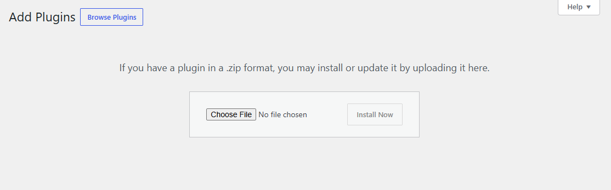

4. Click **Activate Plugin**.

### Updating it

The plugin does not update itself, since it does not come from the plugin directory. When there is a new release, download its zip and upload it the same way. WordPress notices that the plugin is already installed and offers to **Replace current with uploaded**. Your designs and settings stay.

## Using it

### Finding the page

The plugin lives in **Tools → WordPress.org Badges**. Any user who can upload files to the Media Library can use it: authors, editors and administrators.

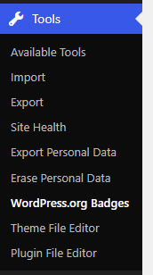

The page has two tabs:

- **My badges**: the badges of a WordPress.org profile, yours or anyone else's.
- **Any badge**: every badge there is, to make an image with whichever you want.

Both tabs work the same way: you pick badges, put them in order and choose how the image looks. Each tab keeps its own design.

### Step 1: load your profile

In **My badges**, type your WordPress.org username, as in your profile URL (`https://profiles.wordpress.org/username/`), and click **Load badges**.

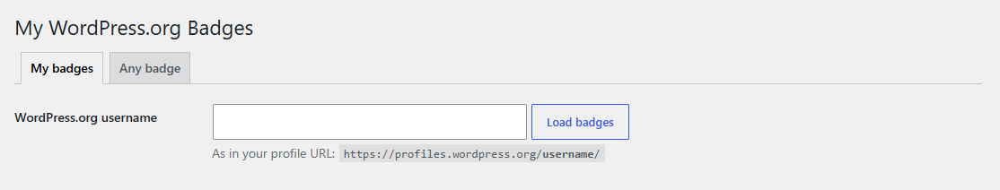

The plugin reads the profile from WordPress.org and keeps it for 12 hours, so it does not ask every time. If you have just earned a badge, click **Read the profile again from WordPress.org**.

### Step 2: pick your badges

The first time, every badge of the profile is picked, with a check mark. Click a badge to leave it out of the image, and click it again to add it back. **All** and **None** pick or drop them all at once.

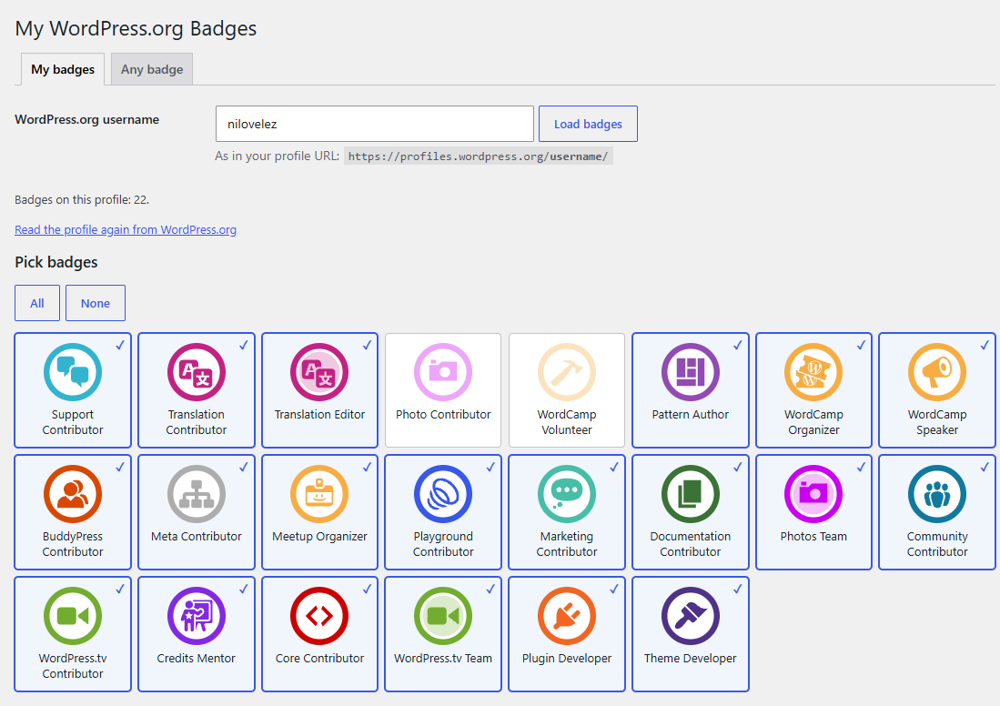

When you come back later, everything is as you left it. New and lost badges are taken care of too. A badge you earned since your last visit shows up marked as **New**, not picked yet, so you decide whether it goes into your image. A badge that is no longer on your profile is taken out, with a notice.

### Step 3: put them in order

The **Order** list has the picked badges, in the order they will appear in the image: left to right, then top to bottom.

- Drag a badge by its handle to move it.
- Or use the **↑** and **↓** buttons, which also work from the keyboard.
- **✕** takes a badge out of the image.
- **Sort by** puts them all in profile order, by name or by team at once.

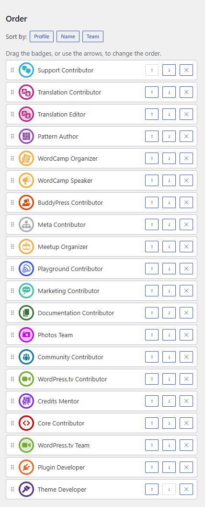

### Step 4: choose how the image looks

Under **Image**:

- **Columns**: how many badges go in each row.
- **Badge size**: the size of each badge, in pixels.
- **Gap**: the space between badges, in pixels.
- **Format**:
  - **PNG**: an image of exactly the size shown under the preview. Right for most uses.
  - **SVG**: an image that scales to any size without losing quality. For print or for designers.

The preview shows the image as it will be, on a checkered background: the real image has a transparent background, so it fits on any color.

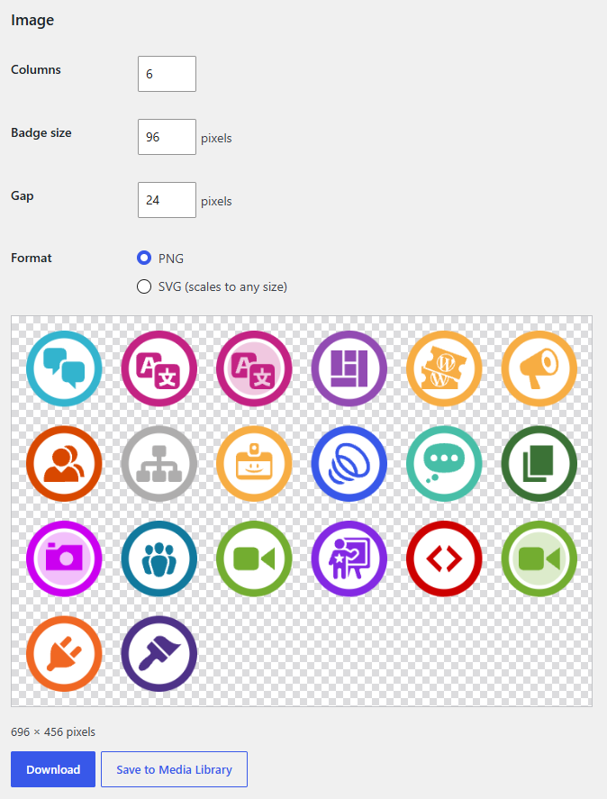

With a single badge picked there is no grid, so **Columns** and **Gap** go away and you get that badge alone.

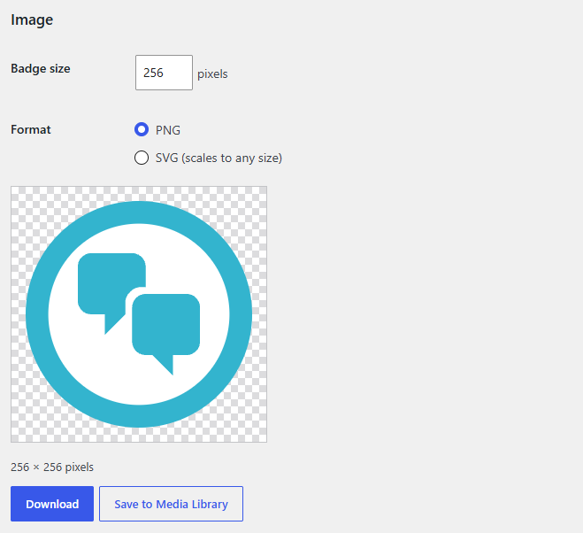

### Step 5: download it or save it to the Media Library

**Download** saves the image to your computer. **Save to Media Library** adds it to your site's Media Library, with a title and the badge names as alternative text, ready for your posts and pages. A link takes you to the new image.

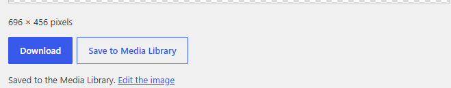

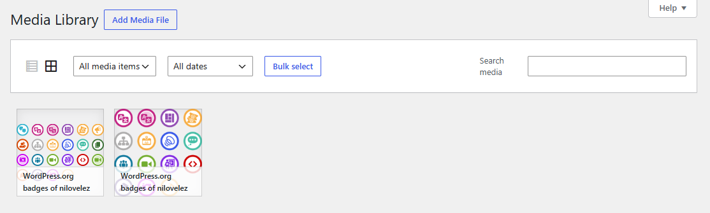

#### SVG in the Media Library

WordPress does not accept SVG files in the Media Library, as a safety measure. Administrators see one more option under the buttons: **Allow saving SVG images to the Media Library on this site**. With it on, the plugin saves the SVG images it builds itself from its own badge files. Any other SVG upload stays blocked.

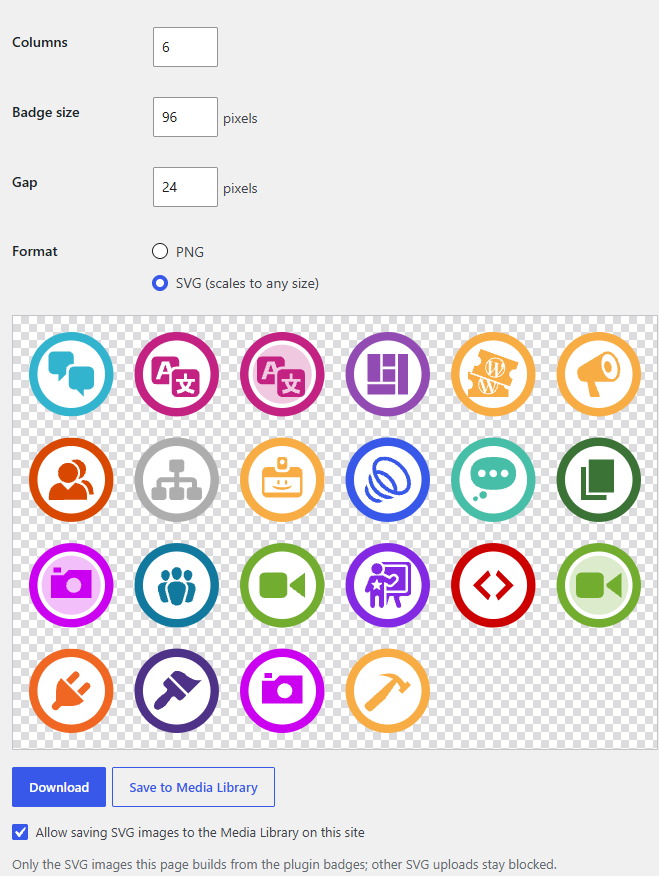

Downloading an SVG works for everyone, with or without this option.

### Any badge

The **Any badge** tab has every badge, not just yours. Use it for the badge of a team for a Contributor Day, for example, or for the badges of the teams taking part in an event. No badge is picked at first.

Search by badge name or team:

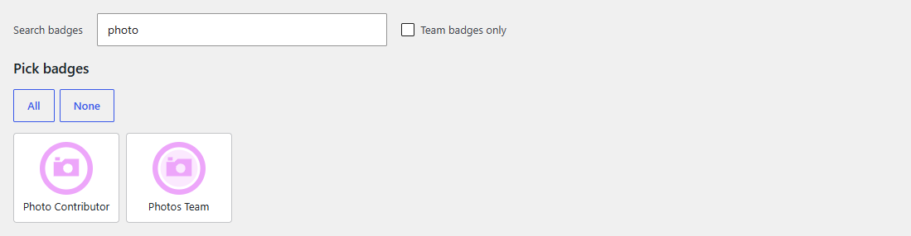

Or tick **Team badges only** to see only the team badges:

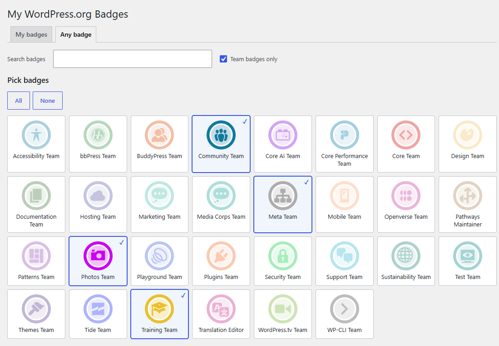

From there it works just like **My badges**: order, image, download or Media Library.

### Saving a design to a file

Under **Settings file**:

- **Export settings** saves your design to a small file, `cute-wp-badges-<yyyymmdd>.json`. The design is the badges, their order and the image options. Your username is not saved.
- **Import settings** loads such a file into the current tab, on the same site or on another one.

Exporting is handy to keep the design of an event, to make the same image again with a new badge, or to share a layout with someone else. In **My badges**, any badge of the file that is not on the loaded profile is left out, and the page tells you which ones.

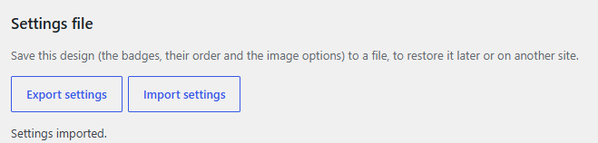

### What you get

One badge, as a 256 × 256 PNG:


A grid, as an SVG that scales to any size:

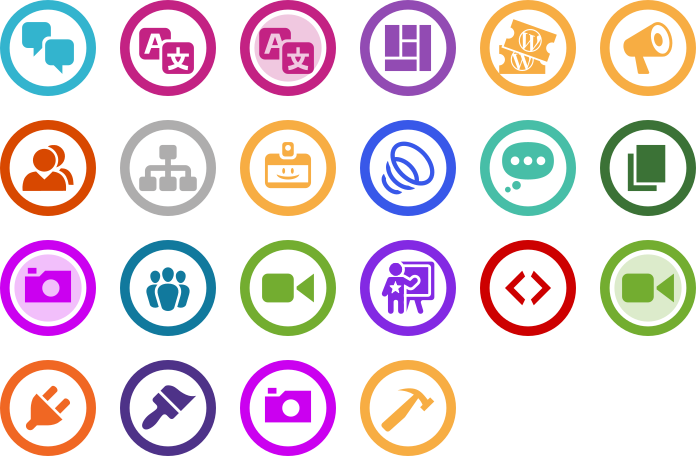

## Questions

**A badge is missing.** The plugin knows the badges that existed when it was released. If your profile has a newer one, the page says so: install the latest release, or update the badge list yourself (see [Updating the badge catalog](#updating-the-badge-catalog)).

**Who can use it?** Any user who can upload files to the Media Library (authors, editors and administrators). Each user has their own designs.

**What does it store?** Each user's designs, the profiles it read in the last 12 hours and the SVG option. Deleting the plugin removes all of that. The images saved to the Media Library stay.

**Does it send my data anywhere?** No. It only reads the public profile page on profiles.wordpress.org, from your server.

## For developers

### How it works

WordPress.org has no public API for badges, so the plugin reads the groups tab of the profile (`https://profiles.wordpress.org/<username>/groups/`) on the server, through its REST route `GET /wp-json/cute-wp-badges/v1/badges/<username>`, and keeps the result for 12 hours in a transient. Add `?refresh=true` to read the profile again. Details in [docs/wporg-profile-api.md](docs/wporg-profile-api.md).

The page saves each tab's state per user through `POST /wp-json/cute-wp-badges/v1/state/<tab>`, into user meta. PNG images go to the Media Library through the core route `POST /wp-json/wp/v2/media`, and SVG images through `POST /wp-json/cute-wp-badges/v1/media`, only while the site option `cute_wp_badges_allow_svg` is on: that route takes badge ids and the layout, never markup, and builds the SVG on the server the same way the badge library does. The plugin routes need the `upload_files` capability, and the option can only be changed by users who can manage options.

The page is plain script modules with no build step (`resources/js/`), which is why it needs WordPress 6.6 or later. The settings file is JSON: `{ "plugin": "cute-wp-badges", "version": 1, "badges": [...], "columns", "size", "gap", "format" }`.

### The badges

Every badge ships as a finished SVG file in `resources/badges/<id>.svg`: the ring, the white border, the tinted circle of team badges (a solid color, no transparency) and the icon, all in the badge color, with a transparent background outside the ring. The files are scale-free (a `viewBox`, no fixed size) and clean: no ids, classes, styles, metadata, comments, embedded data or external references.

They are built from the catalog and the icons in `resources/icons/` by `composer build-badges` (`scripts/build-badges.mjs`), which sanitizes each icon with an allowlist on the way in. `composer validate-badges` checks that every badge has its file, up to date and clean. The icons themselves are only a source for the build and stay out of the plugin zip.

### The badge library

`resources/js/cute-wp-badges.js` gives you any badge of the catalog, or a grid of them, as SVG or PNG. It is a plain ES module with no build step, and works in the browser and in Node 18 or later:

```js
import { renderBadge, renderGrid } from './resources/js/cute-wp-badges.js';

const svg = await renderBadge( 'translation-contributor' );                                // the badge file as it is
const png = await renderBadge( 'translation-contributor', { format: 'png', size: 500 } );    // 500 × 500 PNG
const grid = await renderGrid( [ 'core-contributor', 'polyglots-team', 'photos-team' ], { format: 'png', columns: 5 } );
```

- `renderBadge( id, { format, size } )`: `id` is the badge id (the WordPress.org association slug) or one of its aliases; `format` is `'svg'` (default) or `'png'`. As SVG it returns the badge file as it is. As PNG it draws it `size` pixels wide and high, from 1 to 4096 (default 128).
- `renderGrid( ids, { columns, size, gap, format } )`: lays the badges out left to right and top to bottom, `columns` per row (default 5, fewer if there are fewer badges), each `size` wide (default 128) with `gap` between them (default 32), on a transparent background. As SVG, it nests each badge file as it is inside one scale-free SVG, where `size` and `gap` only set the proportions. As PNG, the whole grid is rasterized at once, up to 8192 pixels on each side.
- Both return SVG markup as a string, or the PNG as a `Blob` in the browser and a `Buffer` in Node, and throw on an unknown badge, format or out-of-range number.
- `getBadges()`: every badge in the catalog. `getBadge( id )`: one badge, or `null`.

The library reads the catalog and the badge files relative to its own file, so it has to stay in the plugin folder structure. In the browser, PNG output is drawn with a canvas. In Node it needs `@resvg/resvg-js`: run `npm install` in the repo.

To check it by eye, `npm run samples` renders into `samples/` (not committed) one SVG and one PNG per badge, a sheet with all of them, and `reference-grid.svg` and `.png`, the badges of [docs/reference-badges.png](docs/reference-badges.png) in the same order to compare with it. `preview.html` shows each badge drawn with plain CSS next to its composed SVG file.

### Updating the badge catalog

The plugin ships with the list of WordPress.org badges that existed when it was released. Badges change rarely, but when a WordPress.org team adds or renames one, the catalog has to be updated and the plugin packaged again.

You need Git, Node.js 18 or later and Composer.

1. Clone the repository and go into it:

   ```bash
   git clone https://github.com/nilovelez/cute-wp-badges.git
   cd cute-wp-badges
   ```

2. Update the catalog from WordPress.org:

   ```bash
   composer update-badges
   ```

   It reads the official list of badges (https://profiles.wordpress.org/associations/) and the WordPress.org profile CSS, updates `data/badges.json` and the team icons in `resources/icons/custom/`, composes the badge files in `resources/badges/`, validates the catalog and rebuilds `preview.html`. It prints what changed:

   - `NEW`: a badge that was not in the catalog. It is added with what can be worked out automatically. The fields it could not work out are left empty (`null`).
   - `RENAMED`: a badge whose name changed on WordPress.org. The new name is applied.
   - `GONE`: a badge that is no longer on WordPress.org. It is not removed; remove it by hand if it is really gone.
   - `COLOR`: the catalog and the profile CSS disagree on a color. Nothing is changed. Check the profile badges handbook (https://make.wordpress.org/meta/handbook/tutorials-guides/profile-badges/) and decide.
   - `CLASS`: a badge class in the profile CSS that no badge uses, usually a sign of a new badge.

3. Complete the new badges by hand in `data/badges.json`. Usually that means `teamUrl` (the team's page) and, for Dashicons, `icon`, which the handbook lists for each team. Every field is described in [docs/badges.md](docs/badges.md).

4. Compose the badges again and validate the catalog:

   ```bash
   composer build-badges
   composer validate-badges
   ```

   `build-badges` rewrites the badge files in `resources/badges/` with your changes. `validate-badges` checks every field, that each badge's icon file exists in `resources/icons/`, and that each badge file is up to date and clean. If it reports errors, go back to step 3 and run both again until it reports none. Then open `preview.html` in a browser to check the new badges by eye.

5. Raise the plugin version in the `Version:` header of `cute-wp-badges.php` and commit everything, saying that the badge catalog was updated:

   ```bash
   git add -A
   git commit -m "Update the badge catalog"
   ```

   Commit before building the zip: `git archive` only packs committed files, and reads the `.gitattributes` of the commit to decide what to leave out.

6. Build the plugin zip:

   ```bash
   git archive --format=zip --prefix=cute-wp-badges/ -o cute-wp-badges-<version>.zip HEAD
   ```

   Development files are left out (see `.gitattributes`).

## License

GPL-2.0-or-later. See [LICENSE](LICENSE).
